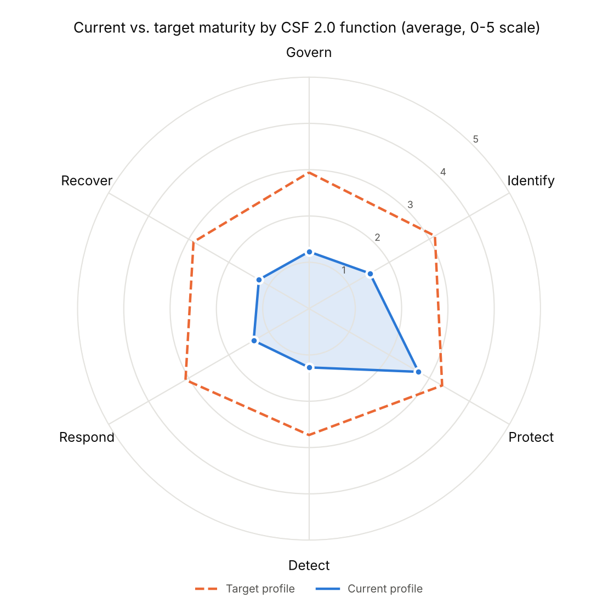
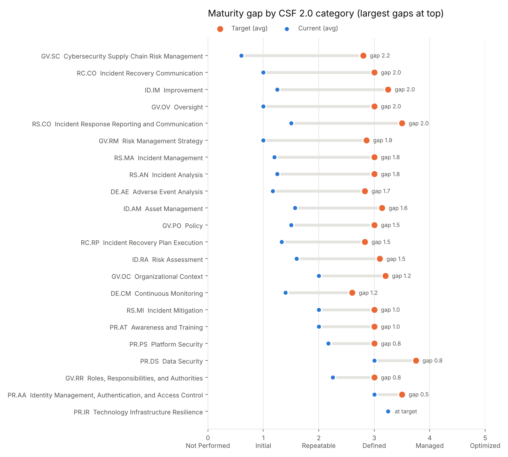

# NIST CSF 2.0 Gap Assessment: Healthcare SaaS Company

A complete cybersecurity maturity gap assessment of a fictional healthcare SaaS company, **Bluefin Health Analytics**, against all **106 subcategories** of the **NIST Cybersecurity Framework 2.0**. The assessment covers the new **Govern** function and produces a prioritized 12-month remediation roadmap.

> ⚠️ **Disclaimer:** Bluefin Health Analytics is a fictional organization created for this portfolio project. All findings, scores, and evidence are simulated.



## Key results

| Metric | Value |
|---|---|
| Subcategories assessed | 106 (6 functions, 22 categories) |
| Current average maturity | **1.62 / 5** |
| Target average maturity | **3.05 / 5** |
| Subcategories with a gap | 91 |
| Subcategories already at target | 15 |
| Phase 1 actions (0–90 days) | 22 |
| Weakest function | **Govern** (1.23), driven by supply chain risk management (0.60) |
| Strongest function | **Protect** (2.73), with universal MFA, encryption, and segmentation |

**Bottom line:** Bluefin's technical controls are solid, but it lacks a risk management foundation, a third-party risk program, and tested incident response and recovery capabilities. These gaps block enterprise sales and create HIPAA exposure.

## Repository contents

```
.
├── README.md
├── data/
│   └── csf2_assessment.csv        # Source data: 106 subcategories, scored, with evidence and recommendations
├── docs/
│   ├── 01-company-profile.md      # Fictional company (Bluefin Health Analytics), tech stack, scope
│   ├── 02-methodology.md          # Maturity scale, target-setting, prioritization formula
│   ├── 03-executive-summary.md    # Board-ready summary and decisions requested
│   ├── 04-detailed-findings.md    # Findings by function and category, top 15 gaps
│   └── 05-remediation-roadmap.md  # Phased roadmap with owners, budget, and KPIs
├── scripts/
│   ├── analyze.py                 # Validates data, scores gaps, assigns phases, builds charts
│   └── requirements.txt
└── outputs/
    ├── scored_assessment.csv      # Full results with gap, priority score, and phase
    ├── function_summary.csv
    ├── category_summary.csv
    ├── top_15_gaps.csv
    ├── function_radar.png
    ├── category_gaps.png
    └── roadmap_phases.png
```

## Where to start

| If you are… | Read |
|---|---|
| A hiring manager with 2 minutes | [Executive Summary](docs/03-executive-summary.md) |
| A GRC practitioner | [Methodology](docs/02-methodology.md) → [Detailed Findings](docs/04-detailed-findings.md) |
| Interested in the plan | [Remediation Roadmap](docs/05-remediation-roadmap.md) |
| Interested in the data | [`outputs/scored_assessment.csv`](outputs/scored_assessment.csv) |

## Methodology in brief

1. **Scope and context:** a HIPAA Business Associate on AWS with 220 employees and ~140 SaaS vendors.
2. **Current Profile:** each subcategory scored on a 0–5 maturity scale (Not Performed → Optimized).
3. **Target Profile:** risk-based targets, mostly level 3 (Defined), with level 4 for PHI-critical outcomes.
4. **Prioritization:** `Priority Score = (Target − Current) × Business Priority weight (High 3 / Medium 2 / Low 1)`
5. **Roadmap:** score >= 6 -> Phase 1 (0–90 days); 3–5 -> Phase 2 (3–6 months); 1–2 -> Phase 3 (6–12 months).



## Reproduce the analysis

```bash
pip install -r scripts/requirements.txt
python scripts/analyze.py
```

The script checks that all 106 subcategories are present and unique, that scores are in range, and that targets are not below current maturity. It then regenerates everything in `outputs/`. To run your own assessment, edit `data/csf2_assessment.csv` and re-run it.

## Skills demonstrated

- **Framework expertise:** NIST CSF 2.0 (all functions, including Govern), with references to NIST SP 800-30, SP 800-61 Rev. 3, HIPAA Security Rule, and SOC 2
- **Gap analysis:** current versus target profiling and risk-based target setting
- **Risk prioritization:** a transparent, repeatable scoring model
- **Executive communication:** a board-ready summary with clear decisions requested
- **Program planning:** a phased roadmap with owners, dependencies, budget, and KPIs
- **Automation:** Python (pandas, matplotlib) for validation, scoring, and visualization

## Related frameworks

Many CSF 2.0 outcomes map to other frameworks. Possible extensions to this project:
- Crosswalk to **ISO/IEC 27001:2022 Annex A**, **SOC 2 Trust Services Criteria**, and the **HIPAA Security Rule** using NIST's official CSF 2.0 Informative References
- Convert Phase 1 items into a **risk register** with inherent and residual risk scoring

## References

- NIST, *The NIST Cybersecurity Framework (CSF) 2.0*, NIST CSWP 29, February 2024. https://doi.org/10.6028/NIST.CSWP.29
- NIST, *CSF 2.0 Resource Center*. https://www.nist.gov/cyberframework
- NIST SP 800-30 Rev. 1, *Guide for Conducting Risk Assessments*
- NIST SP 800-61 Rev. 3, *Incident Response Recommendations and Considerations for Cybersecurity Risk Management*

Subcategory outcome text is taken from NIST CSF 2.0, a work of the U.S. Government.

## Author

**Trish Ann Ramirez** – Aspiring GRC / Cybersecurity Analyst
[LinkedIn](https://www.linkedin.com/in/your-profile)
