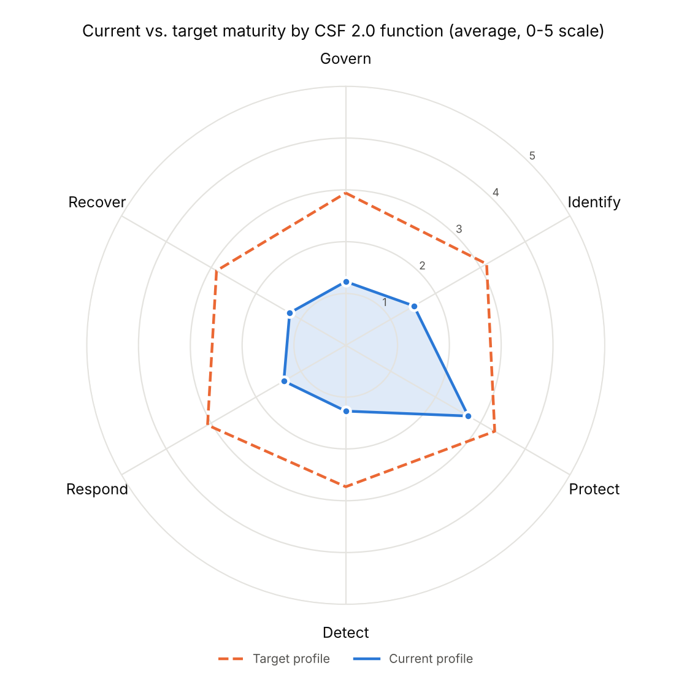
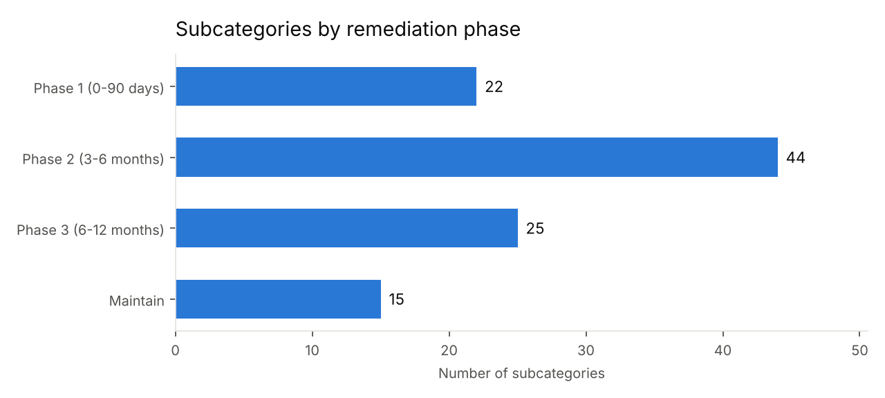

# 03 – Executive Summary

**To:** CEO, CTO, and Board of Directors, Bluefin Health Analytics (fictional)
**From:** GRC Analyst
**Subject:** NIST CSF 2.0 Cybersecurity Maturity Gap Assessment

---

## Bottom line

Bluefin has **solid technical protections but weak governance and response capabilities**. Our current average maturity is **1.62 out of 5**, against a target of **3.05**. The biggest risk is not a missing tool. It is that we **cannot show customers, auditors, or regulators that security is managed as a program**, and we are **unprepared to respond to or recover from a major incident**, such as ransomware or a breach at a vendor.

We recommend approving a **12-month remediation roadmap**, starting with **22 high-priority actions in the next 90 days**.

## Results by function

| Function | Current | Target | Gap | Assessment |
|---|---|---|---|---|
| **Govern** | 1.23 | 2.94 | 1.71 | 🔴 Largest gap. No risk appetite, no vendor risk program, no metrics, no board reporting. |
| **Respond** | 1.38 | 3.08 | 1.69 | 🔴 IR plan never tested; no severity levels, escalation paths, or breach notification templates. |
| **Identify** | 1.52 | 3.14 | 1.62 | 🟠 No formal risk assessment in two years; PHI locations not inventoried. |
| **Recover** | 1.25 | 2.88 | 1.62 | 🟠 Backups exist, but there is no DR plan, restore priority, or integrity check before restore. |
| **Detect** | 1.27 | 2.73 | 1.45 | 🟠 Good signal sources (GuardDuty, EDR), but no SIEM, no runbooks, and alerts go to an inbox. |
| **Protect** | 2.73 | 3.32 | 0.59 | 🟢 Strongest area: universal MFA, encryption in transit and at rest, network segmentation. |

## Key findings

1. **There is no risk management foundation (GV.RM).** Bluefin has no risk appetite statement, no standard scoring method, and no risk register. Without these, security spending and risk acceptance decisions are made ad hoc.
2. **Third-party risk is unmanaged (GV.SC, average 0.6).** About 140 SaaS vendors are in use, with no inventory, tiering, due diligence, or monitoring. Large health-system customers ask about this first, and it is a leading cause of healthcare breaches.
3. **We don't know where all our PHI is (ID.AM-07).** Without a data inventory, we cannot fully protect PHI, scope a SOC 2 audit, or estimate the impact of a breach.
4. **Incident response is untested (ID.IM-04, RS.MA, RS.CO).** The 2023 IR plan has never been exercised. There are no incident criteria, severity levels, or notification templates, so meeting HIPAA's breach notification deadlines would be at risk.
5. **Recovery depends on individual knowledge (RC.RP).** Backups are automated but are not immutable and are not verified before restoration. This is a critical weakness against ransomware.
6. **Privileged access is too broad (PR.AA-05).** Twelve engineers have standing AWS admin access and access is never reviewed.

## Strengths to sustain

- **MFA is enforced for 100% of the workforce** (PR.AA-03).
- **Encryption** is in place for data in transit (TLS 1.2+, mTLS) and most data at rest (PR.DS-01, PR.DS-02).
- **Cloud resilience:** multi-AZ architecture, auto-scaling, and segmentation (PR.IR).
- **Awareness training** is at 94% completion, with monthly phishing simulations (PR.AT-01).

15 of the 106 subcategories already meet their target.

## Recommended roadmap

| Phase | Timeline | Items | Focus |
|---|---|---|---|
| **Phase 1** | 0–90 days | 22 | Risk foundation, vendor risk program, PHI inventory, IR plan, DR plan, privileged access |
| **Phase 2** | 3–6 months | 44 | SIEM and detection, policy suite, KPIs and board reporting, playbooks, pen test |
| **Phase 3** | 6–12 months | 25 | Refinement: CIS hardening baselines, SBOM, threat intel, RACI, on-call rotation, root cause analysis |

See [05-remediation-roadmap.md](05-remediation-roadmap.md) for the full plan with owners.

## Decisions requested from leadership

1. **Approve** the 12-month roadmap and the Phase 1 priorities.
2. **Sponsor** a risk appetite workshop with the executive team within 30 days (GV.RM-02).
3. **Fund** a SIEM or managed detection and response (MDR) service, and one additional GRC/TPRM analyst.
4. **Establish** a quarterly cybersecurity briefing to the board (GV.RR-01).

## Expected outcome

Completing Phases 1 and 2 would raise average maturity from **1.62 to roughly 2.8**. That would put Bluefin in a credible position to start a **SOC 2 Type II observation period**, answer customer security questionnaires with evidence, and meet its HIPAA Business Associate obligations.
