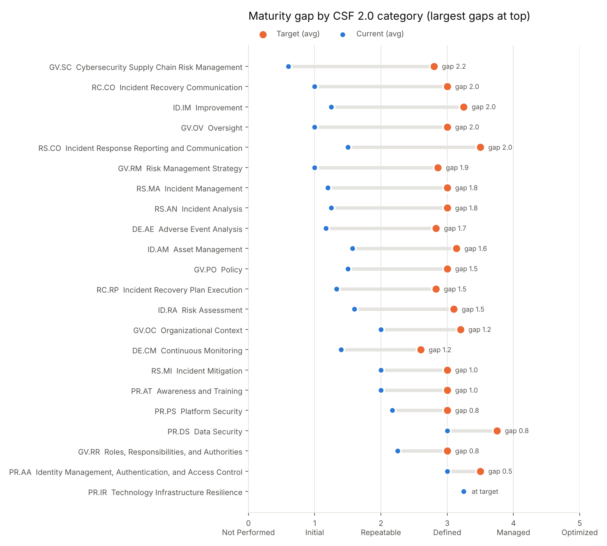

# 04 – Detailed Findings

This document summarizes findings for each function and category. The full scored assessment, with all 106 subcategories, observations, recommendations, and owners, is in [`outputs/scored_assessment.csv`](../outputs/scored_assessment.csv), and GitHub renders it as a searchable table.

**Legend:** Current → Target (average, 0–5 scale). 🔴 gap ≥ 1.75 · 🟠 gap 1.0–1.74 · 🟢 gap < 1.0

---

## GOVERN (GV): 1.23 → 2.94

Govern is the weakest function and accounts for the largest share of total priority score (122 of 350).

| Category | Current → Target | Status | Summary |
|---|---|---|---|
| GV.OC Organizational Context | 2.00 → 3.20 | 🟠 | Mission is understood, but legal/regulatory obligations (HIPAA, BAAs, state laws) are not mapped to controls, and dependencies are undocumented. |
| GV.RM Risk Management Strategy | 1.00 → 2.86 | 🔴 | No risk appetite statement (scored 0), no standard risk scoring method, and no link to enterprise risk management. |
| GV.RR Roles, Responsibilities, and Authorities | 2.25 → 3.00 | 🟢 | Leadership is supportive and HR practices include security, but there is no board reporting and no RACI outside the security team. |
| GV.PO Policy | 1.50 → 3.00 | 🟠 | Core policy exists but is outdated (2023) and incomplete. |
| GV.OV Oversight | 1.00 → 3.00 | 🔴 | No KPIs, KRIs, or periodic strategy reviews. |
| GV.SC Supply Chain Risk Management | 0.60 → 2.80 | 🔴 | **Largest gap in the assessment.** No TPRM (Third-Party Risk Management) program, vendor inventory, due diligence, contract security clauses, or monitoring. |

**Key risk:** Without a risk appetite and a vendor risk program, Bluefin cannot answer the questions that are blocking its large customer deals.

## IDENTIFY (ID): 1.52 → 3.14

| Category | Current → Target | Status | Summary |
|---|---|---|---|
| ID.AM Asset Management | 1.57 → 3.14 | 🟠 | Laptops are inventoried, but cloud resources are inconsistently tagged and **there is no PHI data inventory** (ID.AM-07). Data flow diagrams are from 2022. |
| ID.RA Risk Assessment | 1.60 → 3.10 | 🟠 | Vulnerability scanning is a strength (3/5), but no formal risk assessment in two years, no pen test in 18 months, and no vulnerability disclosure policy. |
| ID.IM Improvement | 1.25 → 3.25 | 🔴 | The IR plan has never been tested (ID.IM-04) and no exercises are conducted. |

## PROTECT (PR): 2.73 → 3.32

Protect is the most mature function and reflects strong engineering practices.

| Category | Current → Target | Status | Summary |
|---|---|---|---|
| PR.AA Identity and Access | 3.00 → 3.50 | 🟢 | **Strength:** universal MFA (4/5). **Gap:** 12 engineers with standing AWS admin access and no access reviews (PR.AA-05, Phase 1). |
| PR.AT Awareness and Training | 2.00 → 3.00 | 🟠 | 94% completion on general training; no role-based training for developers or admins. |
| PR.DS Data Security | 3.00 → 3.75 | 🟢 | Strong encryption. Backups are not immutable and restores are rarely tested; PHI appears in debug logs. |
| PR.PS Platform Security | 2.17 → 3.00 | 🟢 | No patch SLA for servers/containers, 14-day log retention, local admin rights on laptops, and partial SAST coverage. |
| PR.IR Infrastructure Resilience | 3.25 → 3.25 | ✅ | Meets target: segmentation, WAF, multi-AZ, auto-scaling. |

## DETECT (DE): 1.27 → 2.73

| Category | Current → Target | Status | Summary |
|---|---|---|---|
| DE.CM Continuous Monitoring | 1.40 → 2.60 | 🟠 | GuardDuty and EDR provide good signals, but alerts go to an inbox. Identity logs and third-party access are not monitored. |
| DE.AE Adverse Event Analysis | 1.17 → 2.83 | 🟠 | No SIEM, no correlation, no runbooks, and no criteria for declaring an incident (DE.AE-08). |

**Key risk:** A credential-theft attack against Okta or Google Workspace would likely go unnoticed.

## RESPOND (RS): 1.38 → 3.08

| Category | Current → Target | Status | Summary |
|---|---|---|---|
| RS.MA Incident Management | 1.20 → 3.00 | 🔴 | IR plan never executed; no severity scheme or escalation matrix; no pre-arranged outside counsel or forensics firm. |
| RS.AN Incident Analysis | 1.25 → 3.00 | 🔴 | No evidence handling procedure; short log retention limits forensic investigation. |
| RS.CO Reporting and Communication | 1.50 → 3.50 | 🔴 | No breach notification templates or contact lists, which puts HIPAA notification deadlines at risk. |
| RS.MI Incident Mitigation | 2.00 → 3.00 | 🟠 | EDR host isolation works; cloud containment playbooks are missing. |

## RECOVER (RC): 1.25 → 2.88

| Category | Current → Target | Status | Summary |
|---|---|---|---|
| RC.RP Recovery Plan Execution | 1.33 → 2.83 | 🟠 | No DR plan, no restore priority order, and backup integrity is not verified before restoration. |
| RC.CO Recovery Communication | 1.00 → 3.00 | 🔴 | No customer or public communication plan for recovery. |

**Key risk:** In a ransomware event, Bluefin could restore from compromised backups and would have no plan for which services to restore first or how to communicate with customers.

---

## Top 15 gaps by priority score

Full table: [`outputs/top_15_gaps.csv`](../outputs/top_15_gaps.csv)

| # | Subcategory | Gap | Priority | Score | Owner |
|---|---|---|---|---|---|
| 1 | GV.RM-02 Risk appetite and tolerance | 3 | High | 9 | CEO / CISO |
| 2 | GV.SC-01 Supply chain risk program | 3 | High | 9 | GRC / Procurement |
| 3 | ID.AM-07 Data inventory (PHI) | 3 | High | 9 | Security Eng. / Privacy |
| 4 | ID.IM-04 IR plan maintained and improved | 3 | High | 9 | Security Ops |
| 5 | GV.SC-03 Supply chain risk in ERM | 3 | Medium | 6 | GRC |
| 6 | GV.SC-07 Ongoing supplier risk monitoring | 3 | Medium | 6 | GRC |
| 7 | GV.OC-03 Legal and regulatory requirements | 2 | High | 6 | Legal / GRC |
| 8 | GV.RM-01 Risk management objectives | 2 | High | 6 | CISO |
| 9 | GV.RM-06 Standard risk method | 2 | High | 6 | GRC |
| 10 | GV.SC-04 Suppliers prioritized by criticality | 2 | High | 6 | Procurement |
| 11 | GV.SC-05 Security requirements in contracts | 2 | High | 6 | Legal |
| 12 | GV.SC-06 Supplier due diligence | 2 | High | 6 | GRC |
| 13 | ID.AM-05 Asset prioritization | 2 | High | 6 | GRC |
| 14 | ID.RA-05 Inherent risk understood | 2 | High | 6 | GRC |
| 15 | ID.RA-10 Critical suppliers assessed | 2 | High | 6 | GRC |
